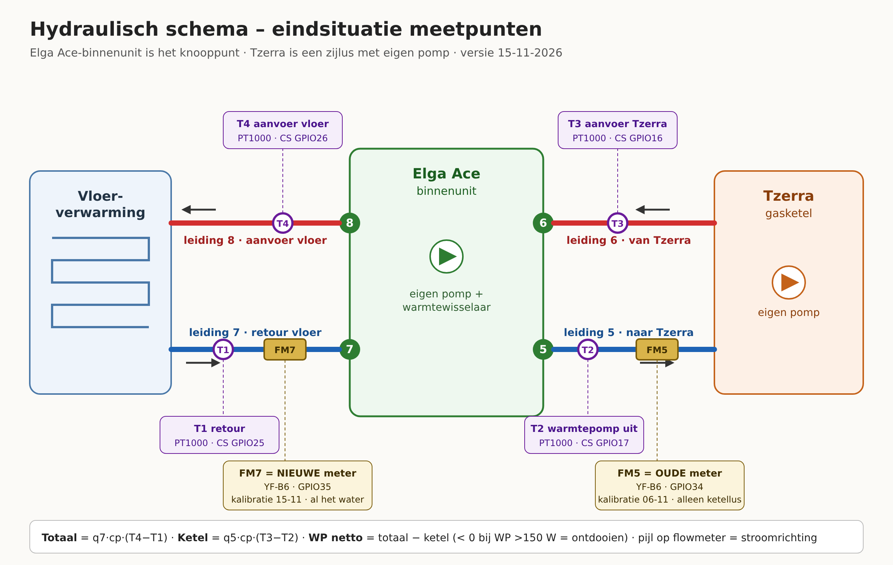
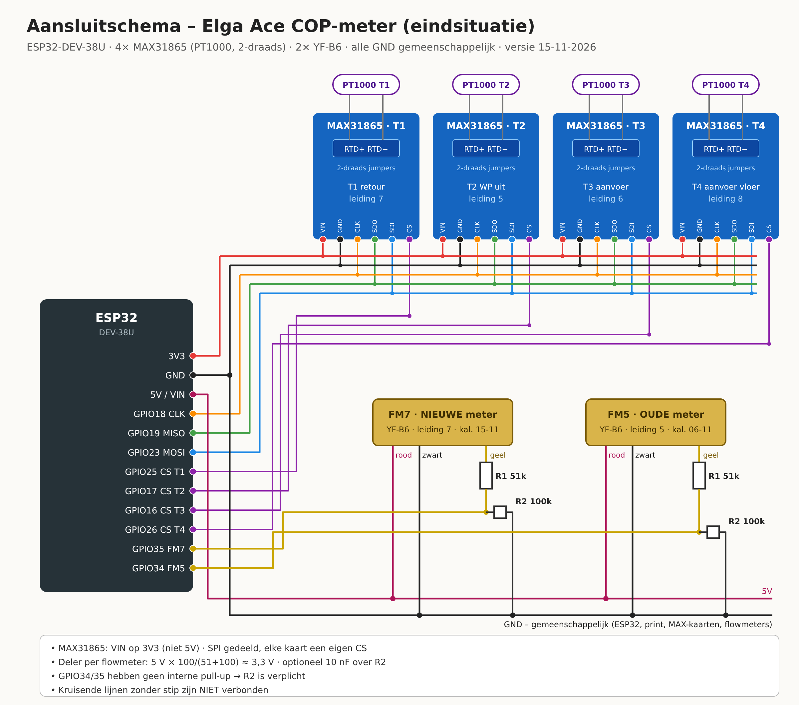

# Elga Ace COP meter

**🇬🇧 English** · [🇳🇱 Nederlands](README.nl.md)


Measure the **real** heat output and COP of a Remeha **Elga Ace** hybrid heat pump (with a Remeha Tzerra or similar gas boiler) in Home Assistant, independently of the Remeha cloud.

An ESP32 with two flow meters and four PT1000 sensors measures the heat flowing to the floor heating and the heat added by the boiler. The heat pump's electrical power comes from an energy meter in Home Assistant, such as a HomeWizard socket. Together they give:

- instantaneous COP, plus daily, monthly and seasonal (SCOP) values
- separate heat output from the heat pump and from the boiler, and the hybrid share
- detection of defrost cycles and the heat lost to defrosting
- COP per outdoor-temperature band
- heating per weighted degree day (kWh/ggd)
- measured boiler efficiency (boiler heat ÷ P1 gas)
- savings in € compared with heating everything with gas
- a comparison of measured values with what the Remeha cloud reports

> ⚠️ **Disclaimer:** this is a hobby project. You will be working on your heating system. If you are not comfortable draining, cutting or soldering pipes, have an installer fit the flow meters. Use at your own risk.

---

## Contents

1. [How it works](#1-how-it-works)
2. [Bill of materials](#2-bill-of-materials)
3. [Sensor placement](#3-sensor-placement)
4. [Wiring](#4-wiring)
5. [ESPHome](#5-esphome)
6. [Calibration](#6-calibration)
7. [Home Assistant](#7-home-assistant)
8. [Dashboard](#8-dashboard)
9. [Clean slate](#9-clean-slate)
10. [Troubleshooting](#10-troubleshooting)
11. [Repository layout](#11-repository-layout)

---

## 1. How it works

In this setup the Elga Ace indoor unit is the hydraulic hub, and the boiler is a side loop with its own pump:

| Pipe | Direction | Measured |
|---|---|---|
| 7 | return from floor → Elga Ace | flow **q7** + **T1** |
| 8 | Elga Ace → supply to floor | **T4** |
| 5 | Elga Ace → boiler return | flow **q5** + **T2** |
| 6 | boiler supply → Elga Ace | **T3** |

The heat balance:

```
Total heat to floor  = q7 · cp · (T4 − T1)
Boiler heat          = q5 · cp · (T3 − T2)      (0 when the boiler loop is idle)
Heat pump net        = total − boiler
   > +0.25 kW            → heat pump delivers heat
   < −0.25 kW, HP >150 W → defrosting (heat taken from the floor loop)
COP                  = heat pump heat / electrical power
```

This stays correct when the Elga Ace mixes water internally or recirculates, because only heat crossing the boundary of the unit is counted.



> Your installation may be piped differently. Check your installation manual before copying the sensor positions.

---

## 2. Bill of materials

| Qty | Part | Notes |
|---|---|---|
| 1 | ESP32 DevKit, 38 pin (e.g. ESP32-DEV-38U) | ESP-IDF framework |
| 4 | Adafruit MAX31865 **PT1000** breakout (ADA-3648) | uses the 4300 Ω reference resistor |
| 4 | PT1000 sensor, class A preferred | immersion sensor, or clamp-on with insulation |
| 2 | YF-B6 flow meter, brass, G3/4" | about 1–25 L/min; fits 22 mm pipe with adapters |
| 2 | 51 kΩ resistor | voltage divider, flow meter signal |
| 2 | 100 kΩ resistor | voltage divider to GND (required) |
| 2 | 10 nF capacitor (optional) | across the 100 kΩ, against noise |
| 1 | 5 V USB power supply | powers the ESP32 and the flow meters |
| 1 | Energy meter for the heat pump | e.g. a HomeWizard socket or kWh meter in HA |
| — | Perfboard, wire, enclosure | an STL is in `hardware/` |

Optional, for the comparison and savings parts: the Remeha integration in HA and a P1 meter for gas.

---

## 3. Sensor placement

- **Flow meters:** fit the arrow in the direction of flow. Leave a straight section of pipe before the meter if you can. Fit the meter in a section that is always water-filled, never at a high point where air collects.
- **PT1000s:** an immersion pocket gives the most accurate reading. For clamp-on sensors, use thermal paste and insulate the sensor and pipe well. Place each pair (T1/T4 and T2/T3) the same way, because the measurement depends on the *difference* between the two sensors.
- **T4** has to sit downstream of every point where water from the boiler loop mixes back in.

---

## 4. Wiring



| Signal | ESP32 |
|---|---|
| SPI CLK / MISO (SDO) / MOSI (SDI) | GPIO18 / GPIO19 / GPIO23 (shared by all boards) |
| CS T1 / T2 / T3 / T4 | GPIO25 / GPIO17 / GPIO16 / GPIO26 |
| Flow meter pipe 7 (yellow) | 51k → **GPIO35**, 100k GPIO35 → GND |
| Flow meter pipe 5 (yellow) | 51k → **GPIO34**, 100k GPIO34 → GND |
| Flow meter red / black | 5 V / GND |
| MAX31865 VIN | **3.3 V** |

Important:
- **All grounds must be connected together:** the ESP32, the perfboard, the MAX31865 boards and both flow meters. A floating ground makes the counter pick up 50 Hz mains noise as pulses, which shows up as phantom flow of several L/min.
- The YF-B6 gives 5 V pulses. The 51k/100k divider brings them down to about 3.3 V.
- GPIO34 and GPIO35 have no internal pull-up, so the 100 kΩ resistor is required.
- Set the MAX31865 boards for 2-wire: bridge the 2/3-wire jumper and wire the PT1000 to RTD+ and RTD−, as shown in the Adafruit guide.
- Do not use strapping pins such as GPIO0, 2, 5, 12 or 15 for chip-select.

---

## 5. ESPHome

1. Copy `esphome/elga-ace-cop.yaml` to your ESPHome folder.
2. Copy `esphome/secrets.example.yaml` to `secrets.yaml` and fill it in. Generate the API key with `openssl rand -base64 32`.
3. Check the `substitutions` at the top:
   - `ha_power_entity`: the HA entity holding the heat pump's electrical power in **W**.
   - `cp_water`: 4.15 (at about 35 °C) is fine. For low return temperatures (25–30 °C), 4.16 is slightly more accurate.
4. **Replace the calibration values with your own** (section 6). The values in the file belong to my sensors.
5. Flash over USB the first time, then over the air.

Design choices in the config:
- `pulse_counter` uses `use_pcnt: false`, a 2 ms `internal_filter` and falling edges. With the hardware counter (PCNT) the counter did not count.
- Every flow sensor has a `calibrate_linear` table (pulses/min → L/min), because a YF-B6 is not linear.
- The heat counters (`integration`) use `restore: true`, so they survive a reboot.
- A sensor's entity ID comes from its `name:`. Rename entities only in HA, never in ESPHome, or every reference breaks.

Entities you get include: Flow (pipe 7), Flow boiler loop (pipe 5), T1 to T4, Delta T heat pump / boiler, total / heat pump / boiler / defrost thermal power, Heat pump heat, Boiler heat, Defrost heat (kWh), Defrost cycles, Last defrost duration, COP instantaneous, Hybrid share, Boiler loop active, Defrosting. The entity names in the config are in Dutch.

---

## 6. Calibration

### 6.1 PT1000 offset (ice bath)

1. Fill a container with **crushed** ice and a little water, stir, and wait 5 minutes.
2. Put all PT1000s in it together, close to each other, and stir now and then.
3. Note each sensor's average reading over a few minutes.
4. Set `offset = 0.00 − measured value` in the `filters:` of each sensor.
5. Optionally check at about 35 °C and 50 °C, with all sensors in the same well-stirred water bath. If the spread between sensors stays within about 0.05 K, you do not need a slope correction.

The *difference* between sensors matters more than the absolute value: at a ΔT of 3 K, a 0.1 K error already gives about 3% error in heat.

### 6.2 Flow meters (bucket test)

Do this with each flow meter on a tap or garden hose, before you fit it:

1. Flash the config with no calibration: temporarily set the filter to `- lambda: return x / 396.0;` (the nominal 6.6 Hz per L/min).
2. Run water through the meter into a bucket for 1–3 minutes, at 3 to 4 different flow rates (low, medium, fully open).
3. **Weigh** the bucket (1 kg ≈ 1 L). Note the start and stop times.
4. From the HA history of *Flow total* (or the pulses/min), work out the pulses per minute and the actual L/min for each test.
5. Enter the points in `calibrate_linear` (pulses/min → actual L/min), always starting with `0.0 -> 0.0`.
6. Run one check test. A deviation within ±1.5% is good.

The calibration belongs to the physical meter, not to the pipe. If you swap meters, the table moves with the meter to the other GPIO.

---

## 7. Home Assistant

1. Turn on packages in `configuration.yaml`, if you haven't already:
   ```yaml
   homeassistant:
     packages: !include_dir_named packages
   ```
2. Copy `homeassistant/packages/*.yaml` to `/config/packages/`. Use filenames without spaces.
3. Copy `homeassistant/custom_templates/warmtepomp.jinja` to `/config/custom_templates/`.
4. **Replace the entity IDs** that belong to my installation:

   | In the files | Replace with your |
   |---|---|
   | `sensor.warmtepomp_power` | heat pump power (W) |
   | `sensor.warmtepomp_energy_import` | heat pump energy (kWh, total_increasing) |
   | `sensor.gas_meter_gas` | P1 gas meter (m³) |
   | `sensor.remeha_heatpump_outdoor_temperature` | outdoor temperature |
   | `sensor.remeha_heatpump_heating_energy_delivered_yesterday` / `_consumed_yesterday` | Remeha integration, daily totals of yesterday (comparison only) |
   | `climate.hele_huis`, `sensor.hele_huis_*` | Remeha zone (dashboard only) |

5. First create two number helpers (box mode) under **Settings → Devices & services → Helpers** for the prices: `input_number.stroomprijs_huidig_tarief` (€/kWh, electricity) and `input_number.gasprijs_per_m3` (€/m³, gas). The packages read prices only from these; without them the cost sensors stay *unavailable*.
6. Restart HA. Then set the gas calorific value (default 9.77 kWh/m³) and the boiler efficiency in the `input_number` helpers, or check them there.
7. Optionally add the script `homeassistant/scripts/cop_schone_lei.yaml`, the "clean slate" script.

What the packages do:
- `warmtepomp_cop.yaml`: utility meters (day, month, season), COP and SCOP, hybrid share, and a COP curve per outdoor-temperature band, built every night at 00:01.
- `warmtepomp_cop_vergelijking.yaml`: measured COP, hybrid share, defrost loss, measured boiler efficiency, net COP.
- `warmtepomp_remeha.yaml`: measured vs Remeha cloud (daily, monthly, seasonal), built from Remeha's 'yesterday' totals without double counting.
- `warmtepomp_besparing.yaml`: savings in € versus gas, using the Jinja macro.
- `warmtepomp_warmwater.yaml`: splits P1 gas into domestic hot water and space heating (combi boiler: burner on via smart plug + no flow in the boiler loop = hot water). Also makes the boiler efficiency figure exclude hot water. Needs a smart plug on the boiler (`sensor.cv_power`).
- `warmtepomp_graaddagen.yaml`: heating per weighted degree day (kWh/ggd) per day, month and season. Weighting follows the Dutch convention: Nov–Feb ×1.1, Mar/Oct ×1.0, Apr–Sep ×0.8; the base temperature defaults to 18 °C.

All utility meters have a `unique_id`. Without one, you get duplicate `_2` entities after a reload.

---

## 8. Dashboard

`homeassistant/dashboards/elga_ace_cop_dashboard.yaml` is a single `vertical-stack` card.

Requirements (install through HACS): **Mushroom**, **apexcharts-card**, **card-mod**.

Add a card, open the code editor and paste the YAML. The "Measured" and "Savings" blocks only show while the ESP32 is online. The "Heating curve & analysis" block is optional and uses entities from the Remeha integration.

---

## 9. Clean slate

Once everything is installed and calibrated, the history may still contain test data, for example from bucket tests. The script **COP schone lei** ("clean slate"):
- purges the history of all COP entities
- resets all utility meters
- clears the COP curve
- restarts the ESP32

The integration totals stored on the ESP32 (such as *Flow total*) are kept. That does no harm, because the utility meters only count changes.

---

## 10. Troubleshooting

| Symptom | Cause / fix |
|---|---|
| Flow shows several L/min with no water flowing | Floating ground → connect every GND together. Add 10 nF across the 100k if needed. |
| Flow counter stays at 0 | Check the divider. Blow through the meter and watch the log. Use `use_pcnt: false`. |
| MAX31865 fault / 0xFFFF | Board not connected or CS wrong. Temporarily set that sensor to `update_interval: never`. |
| T values a fixed amount apart | Redo the ice-bath offset. |
| COP far too high | Flow not calibrated, ΔT sensors badly insulated, or the power entity is not in W. |
| Entities named `_2` in HA | A utility meter without a `unique_id`. Delete the old entity. |
| Package does not load | Space in the filename, or `packages:` not configured. |
| Remeha values jump | The Remeha cloud is unreliable. Use HomeWizard / P1 as the source. |

---

## 11. Repository layout

```
esphome/
  elga-ace-cop.yaml          ESPHome config (ESP32, 4× MAX31865, 2× YF-B6)
  secrets.example.yaml
homeassistant/
  packages/                  utility meters, COP, comparison, savings
  custom_templates/          warmtepomp.jinja (savings macro)
  scripts/cop_schone_lei.yaml
  dashboards/elga_ace_cop_dashboard.yaml
hardware/enclosure/          3D-printable enclosure (PLA), v3 = 3 MAX31865 slots
docs/img/                    hydraulic and wiring diagrams
```

The YAML comments and entity names are in Dutch. The logic is easy to follow with the diagrams above.

The enclosure in `hardware/` has room for 3 MAX31865 boards and 4 cable glands. With 4 boards and 2 flow meters you need more room or extra glands.
