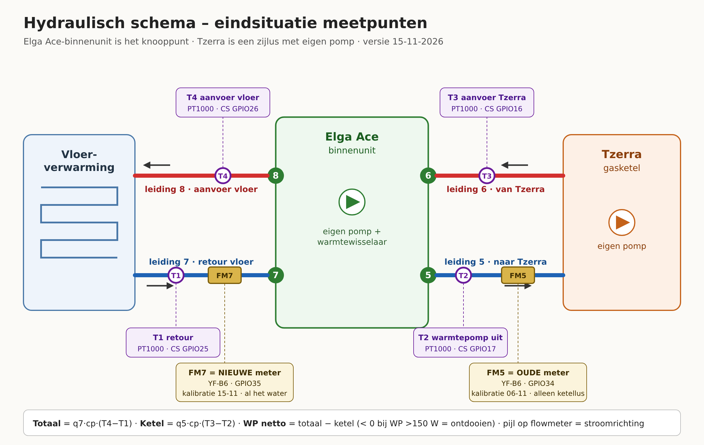
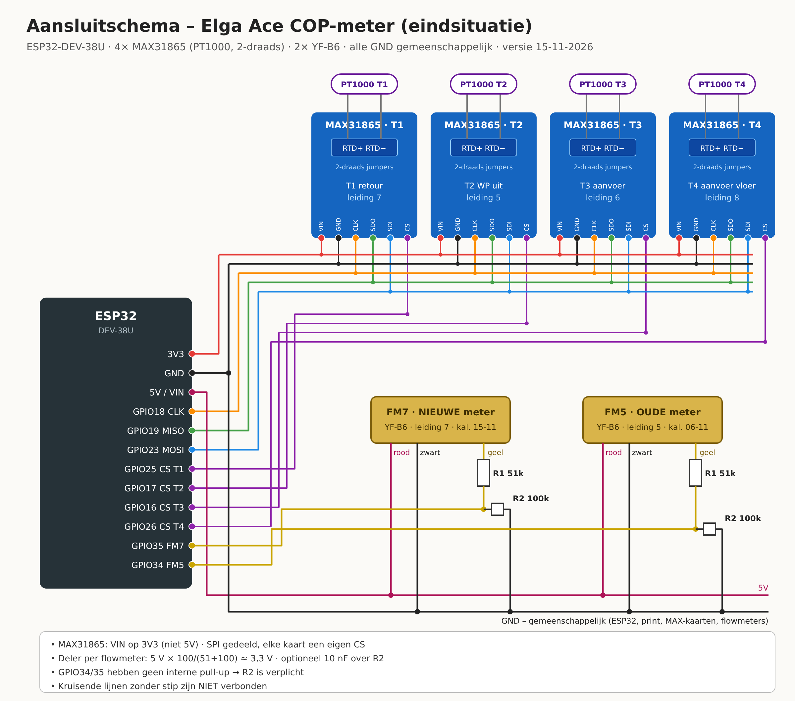

# Elga Ace COP-meter

[🇬🇧 English](README.md) · **🇳🇱 Nederlands**


Meet de **werkelijke** warmteafgifte en COP van een Remeha **Elga Ace** hybride warmtepomp (met een Remeha Tzerra of vergelijkbare cv-ketel) in Home Assistant, los van de Remeha-cloud.

Een ESP32 met twee flowmeters en vier PT1000-voelers meet hoeveel warmte er naar de vloerverwarming gaat en hoeveel de ketel daaraan toevoegt. Het elektrisch vermogen van de warmtepomp komt uit een energiemeter in Home Assistant, bijvoorbeeld een HomeWizard-stekker. Samen levert dat op:

- momentane COP, plus dag-, maand- en seizoenswaarden (SCOP)
- de warmte van warmtepomp en ketel apart, en het hybride aandeel
- herkenning van ontdooicycli en het warmteverlies door ontdooien
- COP per buitentemperatuurband
- verwarming per gewogen graaddag (kWh/ggd)
- gemeten ketelrendement (ketelwarmte ÷ P1-gas)
- besparing in € ten opzichte van alles stoken op gas
- een vergelijking van de gemeten waarden met wat de Remeha-cloud rapporteert

> ⚠️ **Disclaimer:** dit is een hobbyproject. Je werkt aan je cv-installatie. Kun je zelf niet aftappen, zagen of solderen, laat de flowmeters dan door een installateur plaatsen. Gebruik is op eigen risico.

---

## Inhoud

1. [Werking](#1-werking)
2. [Onderdelen](#2-onderdelen)
3. [Plaatsing van de voelers](#3-plaatsing-van-de-voelers)
4. [Bedrading](#4-bedrading)
5. [ESPHome](#5-esphome)
6. [Kalibratie](#6-kalibratie)
7. [Home Assistant](#7-home-assistant)
8. [Dashboard](#8-dashboard)
9. [Schone lei](#9-schone-lei)
10. [Problemen oplossen](#10-problemen-oplossen)
11. [Opbouw van de repository](#11-opbouw-van-de-repository)

---

## 1. Werking

In deze opstelling is de Elga Ace-binnenunit het hydraulische knooppunt. De ketel is een zijlus met een eigen pomp:

| Leiding | Richting | Meting |
|---|---|---|
| 7 | retour van de vloer → Elga Ace | debiet **q7** + **T1** |
| 8 | Elga Ace → aanvoer naar de vloer | **T4** |
| 5 | Elga Ace → retour ketel | debiet **q5** + **T2** |
| 6 | aanvoer ketel → Elga Ace | **T3** |

De energiebalans:

```
Totale warmte naar de vloer = q7 · cp · (T4 − T1)
Ketelwarmte                 = q5 · cp · (T3 − T2)   (0 als de ketellus stilstaat)
Warmtepomp netto            = totaal − ketel
   > +0,25 kW            → warmtepomp levert warmte
   < −0,25 kW, WP >150 W → ontdooien (warmte uit de vloerlus gehaald)
COP                         = warmtepompwarmte / elektrisch vermogen
```

Dit blijft kloppen als de Elga Ace intern mengt of recirculeert, omdat alleen de warmte telt die de grens van de unit passeert.



> Jouw installatie kan anders zijn aangesloten. Controleer je installatiehandleiding voordat je de voelerposities overneemt.

---

## 2. Onderdelen

| Aantal | Onderdeel | Opmerking |
|---|---|---|
| 1 | ESP32 DevKit, 38 pins (bijv. ESP32-DEV-38U) | ESP-IDF-framework |
| 4 | Adafruit MAX31865 **PT1000**-breakout (ADA-3648) | gebruikt de referentieweerstand van 4300 Ω |
| 4 | PT1000-voeler, bij voorkeur klasse A | dompelvoeler, of aanlegvoeler met isolatie |
| 2 | YF-B6-flowmeter, messing, G3/4" | ca. 1–25 L/min; met verloopstukken op 22 mm leiding |
| 2 | Weerstand 51 kΩ | spanningsdeler voor het flowsignaal |
| 2 | Weerstand 100 kΩ | spanningsdeler naar GND (verplicht) |
| 2 | Condensator 10 nF (optioneel) | over de 100 kΩ, tegen storing |
| 1 | 5V-USB-voeding | voedt de ESP32 en de flowmeters |
| 1 | Energiemeter voor de warmtepomp | bijv. HomeWizard-stekker of kWh-meter in HA |
| — | Gaatjesprint, draad, behuizing | STL staat in `hardware/` |

Optioneel, voor de vergelijking en de besparing: de Remeha-integratie in HA en een P1-meter voor gas.

---

## 3. Plaatsing van de voelers

- **Flowmeters:** monteer ze met de pijl in de stroomrichting. Laat er zo mogelijk een recht stuk leiding vóór zitten. Plaats ze in een deel dat altijd met water gevuld is, nooit op een hoog punt waar lucht blijft hangen.
- **PT1000's:** een dompelhuls meet het nauwkeurigst. Gebruik bij aanlegvoelers koelpasta en isoleer voeler en leiding goed. Monteer elk paar (T1/T4 en T2/T3) op dezelfde manier, want de meting hangt af van het *verschil* tussen de twee voelers.
- **T4** moet ná elk punt zitten waar water uit de ketellus terugmengt.

---

## 4. Bedrading



| Signaal | ESP32 |
|---|---|
| SPI CLK / MISO (SDO) / MOSI (SDI) | GPIO18 / GPIO19 / GPIO23 (gedeeld door alle kaarten) |
| CS T1 / T2 / T3 / T4 | GPIO25 / GPIO17 / GPIO16 / GPIO26 |
| Flowmeter leiding 7 (geel) | 51k → **GPIO35**, 100k van GPIO35 → GND |
| Flowmeter leiding 5 (geel) | 51k → **GPIO34**, 100k van GPIO34 → GND |
| Flowmeter rood / zwart | 5 V / GND |
| MAX31865 VIN | **3,3 V** |

Belangrijk:
- **Alle GND's moeten met elkaar verbonden zijn:** de ESP32, de gaatjesprint, de MAX31865-kaarten en beide flowmeters. Bij een zwevende massa telt de teller 50 Hz-netstoring als pulsen. Je ziet dan spookdebiet van enkele L/min.
- De YF-B6 geeft pulsen van 5 V. De deler van 51k/100k brengt die terug naar ongeveer 3,3 V.
- GPIO34 en GPIO35 hebben geen interne pull-up, dus de weerstand van 100 kΩ is verplicht.
- Stel de MAX31865-kaarten in op 2-draads: sluit de 2/3-wire-jumper en sluit de PT1000 aan op RTD+ en RTD−, zoals in de handleiding van Adafruit.
- Gebruik geen strapping-pins zoals GPIO0, 2, 5, 12 of 15 voor CS.

---

## 5. ESPHome

1. Kopieer `esphome/elga-ace-cop.yaml` naar je ESPHome-map.
2. Kopieer `esphome/secrets.example.yaml` naar `secrets.yaml` en vul hem in. Maak de API-sleutel aan met `openssl rand -base64 32`.
3. Controleer de `substitutions` bovenaan:
   - `ha_power_entity`: de HA-entiteit met het elektrisch vermogen van de warmtepomp in **W**.
   - `cp_water`: 4,15 (bij ca. 35 °C) is prima. Bij lage retourtemperaturen (25–30 °C) is 4,16 iets nauwkeuriger.
4. **Vervang de kalibratiewaarden door je eigen waarden** (hoofdstuk 6). De waarden in het bestand horen bij mijn voelers.
5. Flash de eerste keer via USB, daarna draadloos (OTA).

Ontwerpkeuzes in de config:
- `pulse_counter` gebruikt `use_pcnt: false`, een `internal_filter` van 2 ms en dalende flanken. Met de hardwareteller (PCNT) telde de teller niet.
- Elke flowsensor heeft een `calibrate_linear`-tabel (pulsen/min → L/min), omdat een YF-B6 niet lineair is.
- De warmtetellers (`integration`) gebruiken `restore: true`, zodat ze een herstart overleven.
- Het entity-id van een sensor komt van zijn `name:`. Wijzig namen alleen in HA, nooit in ESPHome, anders werkt geen enkele verwijzing meer.

Je krijgt onder andere deze entiteiten: Debiet (leiding 7), Debiet ketellus (leiding 5), T1 t/m T4, Delta T warmtepomp/ketel, Totaal/Warmtepomp/Ketel/Ontdooi thermisch vermogen, Warmtepomp warmte, Ketel warmte, Ontdooi warmte (kWh), Ontdooicycli, Duur laatste ontdooiing, COP momentaan, Hybride aandeel, Ketellus actief, Ontdooien.

---

## 6. Kalibratie

### 6.1 PT1000-offset (ijsbad)

1. Vul een bak met **gemalen** ijs en een beetje water, roer en wacht 5 minuten.
2. Hang alle PT1000's er tegelijk in, dicht bij elkaar, en roer af en toe.
3. Noteer per voeler de gemiddelde waarde over een paar minuten.
4. Vul per voeler in de `filters:` in: `offset = 0,00 − gemeten waarde`.
5. Controleer eventueel bij ca. 35 °C en 50 °C, met alle voelers in hetzelfde goed geroerde waterbad. Blijft de spreiding tussen de voelers binnen ca. 0,05 K, dan is een hellingscorrectie niet nodig.

Het *verschil* tussen de voelers is belangrijker dan de absolute waarde: bij een ΔT van 3 K geeft een fout van 0,1 K al ongeveer 3% fout in de warmte.

### 6.2 Flowmeters (emmertest)

Doe dit per flowmeter aan een kraan of tuinslang, vóór het inbouwen:

1. Flash de config zonder kalibratie: zet het filter tijdelijk op `- lambda: return x / 396.0;` (de nominale 6,6 Hz per L/min).
2. Laat 1 tot 3 minuten water door de meter in een emmer lopen, bij 3 à 4 verschillende debieten (laag, midden, vol open).
3. **Weeg** de emmer (1 kg ≈ 1 L). Noteer de start- en stoptijd.
4. Bepaal uit de HA-geschiedenis van *Debiet totaal* (of de pulsen/min) per test de pulsen per minuut en het werkelijke aantal L/min.
5. Vul de punten in bij `calibrate_linear` (pulsen/min → werkelijk L/min), altijd beginnend met `0.0 -> 0.0`.
6. Doe één controletest. Een afwijking binnen ±1,5% is goed.

De kalibratie hoort bij de fysieke meter, niet bij de leiding. Wissel je meters om, dan verhuist de tabel met de meter mee naar de andere GPIO.

---

## 7. Home Assistant

1. Zet packages aan in `configuration.yaml`, als dat nog niet zo is:
   ```yaml
   homeassistant:
     packages: !include_dir_named packages
   ```
2. Kopieer `homeassistant/packages/*.yaml` naar `/config/packages/`. Gebruik bestandsnamen zonder spaties.
3. Kopieer `homeassistant/custom_templates/warmtepomp.jinja` naar `/config/custom_templates/`.
4. **Vervang de entity-id's** die bij mijn installatie horen:

   | In de bestanden | Vervang door jouw |
   |---|---|
   | `sensor.warmtepomp_power` | vermogen warmtepomp (W) |
   | `sensor.warmtepomp_energy_import` | energie warmtepomp (kWh, total_increasing) |
   | `sensor.gas_meter_gas` | P1-gasmeter (m³) |
   | `sensor.remeha_heatpump_outdoor_temperature` | buitentemperatuur |
   | `sensor.remeha_heatpump_heating_energy_delivered_yesterday` / `_consumed_yesterday` | Remeha-integratie, dagtotalen van gisteren (alleen voor de vergelijking) |
   | `climate.hele_huis`, `sensor.hele_huis_*` | Remeha-zone (alleen het dashboard) |

5. Maak vooraf via **Instellingen → Apparaten & diensten → Helpers** twee getal-helpers (vak-modus) voor de prijzen: `input_number.stroomprijs_huidig_tarief` (€/kWh) en `input_number.gasprijs_per_m3` (€/m³). De packages lezen de prijzen alleen hieruit; zonder deze helpers blijven de kostensensoren *niet beschikbaar*.
6. Herstart HA. Stel daarna in de `input_number`-helpers de calorische waarde van gas (standaard 9,77 kWh/m³) en het ketelrendement in, of controleer ze.
7. Voeg eventueel het script `homeassistant/scripts/cop_schone_lei.yaml` toe.

Wat de packages doen:
- `warmtepomp_cop.yaml`: utility meters (dag, maand, seizoen), COP en SCOP, hybride aandeel en een COP-curve per buitentemperatuurband, die elke nacht om 00:01 wordt opgebouwd.
- `warmtepomp_cop_vergelijking.yaml`: gemeten COP, hybride aandeel, ontdooiverlies, gemeten ketelrendement en netto COP.
- `warmtepomp_remeha.yaml`: gemeten tegenover de Remeha-cloud (dag, maand, seizoen), opgebouwd uit de dagtotalen van gisteren zonder dubbeltelling.
- `warmtepomp_besparing.yaml`: besparing in € ten opzichte van gas, met de Jinja-macro.
- `warmtepomp_warmwater.yaml`: splitst het P1-gas in warm water en cv (combiketel: brander aan via slimme stekker + geen debiet in de ketellus = warm water). Maakt ook het ketelrendement zuiver, zonder tapwater. Vereist een slimme stekker op de ketel (`sensor.cv_power`).
- `warmtepomp_graaddagen.yaml`: verwarming per gewogen graaddag (kWh/ggd) per dag, maand en seizoen. Weegfactoren: nov–feb ×1,1, mrt/okt ×1,0, apr–sep ×0,8; stookgrens standaard 18 °C.

Alle utility meters hebben een `unique_id`. Zonder die id krijg je na een herlaadactie dubbele `_2`-entiteiten.

---

## 8. Dashboard

`homeassistant/dashboards/elga_ace_cop_dashboard.yaml` is één `vertical-stack`-kaart.

Nodig (te installeren via HACS): **Mushroom**, **apexcharts-card** en **card-mod**.

Voeg een kaart toe, open de code-editor en plak de YAML. De blokken "Gemeten" en "Besparing" zijn alleen zichtbaar als de ESP32 online is. Het blok "Stooklijn & analyse" is optioneel en gebruikt entiteiten van de Remeha-integratie.

---

## 9. Schone lei

Als alles is ingebouwd en gekalibreerd, staat er mogelijk nog testdata in de historie, bijvoorbeeld van emmertests. Het script **COP schone lei**:
- wist de historie van alle COP-entiteiten
- zet alle utility meters op nul
- maakt de COP-curve leeg
- herstart de ESP32

De integratietotalen op de ESP32 zelf (zoals *Debiet totaal*) blijven staan. Dat kan geen kwaad, want de utility meters tellen alleen veranderingen.

---

## 10. Problemen oplossen

| Symptoom | Oorzaak / oplossing |
|---|---|
| Debiet van enkele L/min zonder dat er water stroomt | Zwevende massa → verbind alle GND's met elkaar. Zet zo nodig 10 nF over de 100k. |
| Debietteller blijft op 0 | Controleer de deler. Blaas door de meter en kijk in de log. Gebruik `use_pcnt: false`. |
| MAX31865-fout / 0xFFFF | Kaart niet aangesloten of CS verkeerd. Zet die voeler tijdelijk op `update_interval: never`. |
| T-waarden liggen een vast verschil uit elkaar | Doe de ijsbad-offset opnieuw. |
| COP veel te hoog | Debiet niet gekalibreerd, ΔT-voelers slecht geïsoleerd, of de vermogensentiteit is niet in W. |
| Entiteiten met `_2` in HA | Een utility meter zonder `unique_id`. Verwijder de oude entiteit. |
| Package laadt niet | Spatie in de bestandsnaam, of `packages:` niet ingesteld. |
| Remeha-waarden springen | De Remeha-cloud is onbetrouwbaar. Gebruik HomeWizard / P1 als bron. |

---

## 11. Opbouw van de repository

```
esphome/
  elga-ace-cop.yaml          ESPHome-config (ESP32, 4× MAX31865, 2× YF-B6)
  secrets.example.yaml
homeassistant/
  packages/                  utility meters, COP, vergelijking, besparing
  custom_templates/          warmtepomp.jinja (besparingsmacro)
  scripts/cop_schone_lei.yaml
  dashboards/elga_ace_cop_dashboard.yaml
hardware/enclosure/          3D-printbare behuizing (PLA), v3 = 3 MAX31865-sleuven
docs/img/                    hydraulisch schema en aansluitschema
```

De behuizing in `hardware/` heeft plaats voor 3 MAX31865-kaarten en 4 kabelwartels. Met 4 kaarten en 2 flowmeters heb je meer ruimte of extra wartels nodig.
